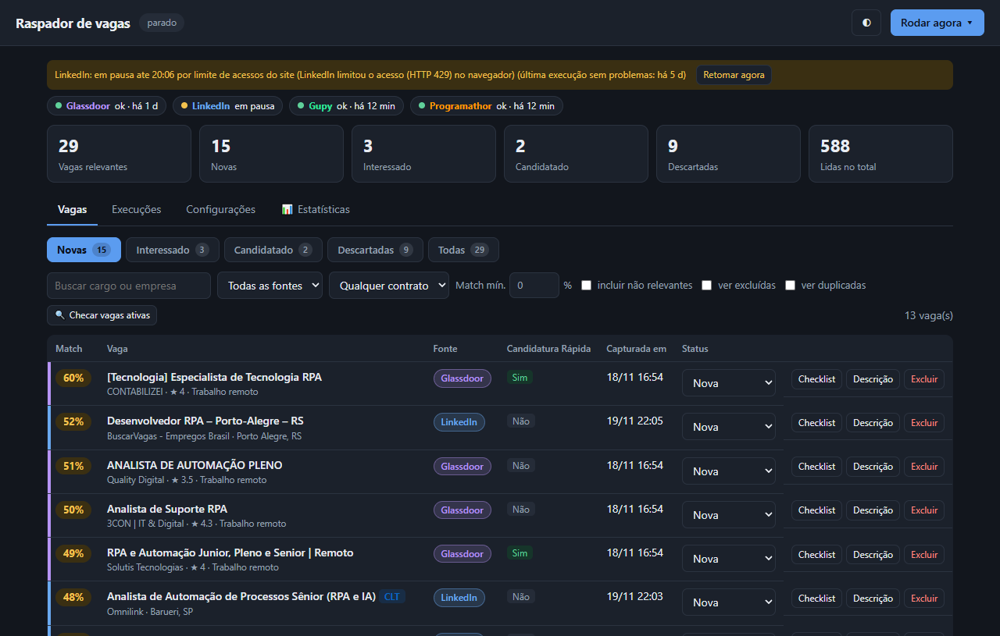
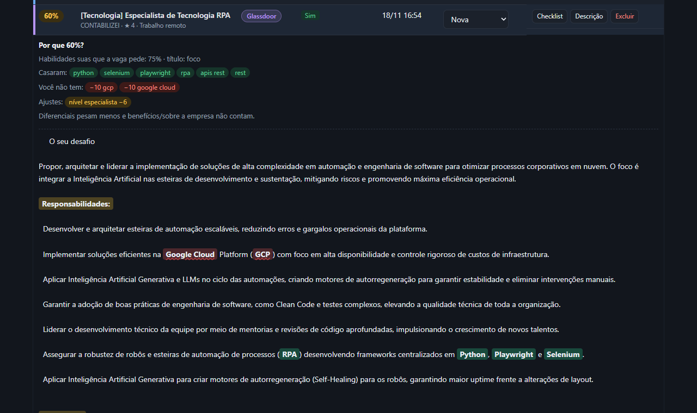
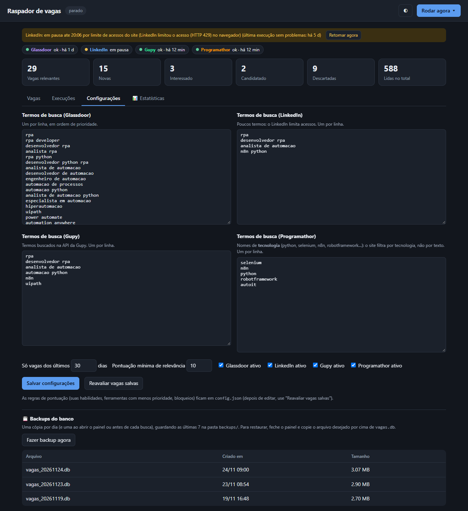

# 🤖 Raspador de Vagas RPA & Tech

[](https://www.python.org/)
[](https://fastapi.tiangolo.com/)
[](https://playwright.dev/)
[](https://www.sqlite.org/)
[](#)
[](https://github.com/GleidsonVian/raspador-de-vagas/actions/workflows/tests.yml)

Sistema autônomo de busca, filtragem e curadoria de vagas **100% remotas** em múltiplas plataformas de emprego (**Glassdoor, LinkedIn, Gupy e Programathor**). 

O raspador calcula a **aderência exata (% de Match)** de cada oportunidade ao seu perfil técnico (pesos por tecnologias, penalidades por lacunas e leitura contextual por seções), identifica salários e tipo de contratação (PJ/CLT), detecta vagas duplicadas e expiradas, e centraliza tudo em um **painel web local interativo e em tempo real**.

---

## 📸 Demonstração Visual das Telas

### 1. Painel de Vagas & Abas de Candidatura
Centralize o funil das suas candidaturas. Mude o status da vaga (*Nova*, *Interessado*, *Candidatado*, *Descartado*) e ela se move suavemente para a respectiva aba, sumindo da sua visão imediata para manter o foco no que importa.


### 2. Leitura Inteligente com Destaque Colorido na Descrição
Abra a descrição completa com 1 clique e veja de imediato:
- 🟩 **Suas habilidades** encontradas no texto (marcadas em verde sutil).
- 🟥 **Lacunas e requisitos faltantes** que você não tem (fundo vermelho com sublinhado ondulado).
- 🟨 **Seções-chave** (*Requisitos, Qualificações, Diferenciais, Atividades*) destacadas em amarelo.
- 🎯 **Card explicativo:** detalha exatamente o porquê da pontuação final da vaga.


### 3. Analytics & Tendências de Mercado
Tenha uma visão estratégica do mercado de RPA e tecnologia a partir das centenas de vagas mineradas no seu banco de dados:
- **Top 12 Tecnologias Mais Demandadas**: frequência de menção (Python, SQL, UiPath, APIs, IA/GenAI, etc.).
- **Médias Salariais Estimadas**: comparativo real de valores médios para CLT e PJ.
- **Distribuição de Contratos e Senioridades**: proporção de vagas para Júnior, Pleno e Sênior.
- **Top Empresas Contratantes**: ranking com atalho clicável para filtrar as vagas da empresa.
- **Desempenho por Plataforma**: volume total, taxa de match médio e vagas relevantes por fonte.


### 4. Configurações & Gestão Multi-Fonte
Ajuste facilmente termos de busca específicos para cada plataforma, idade máxima das vagas, pontuação mínima e ative/desative fontes sem precisar editar arquivos de código.


---

## ⚡ Principais Recursos

- 🌐 **Múltiplas Fontes Integradas**:
  - **Glassdoor**: Coleta via CDP conectando-se ao Microsoft Edge já instalado.
  - **LinkedIn**: busca pública pelo **navegador real (Edge)**, sem login e **sem usar a sua conta**. O LinkedIn fica atrás do Cloudflare, que serve um desafio anti-robô a clientes HTTP simples (o `requests` leva 429 com JavaScript ofuscado, mesmo sem volume); num navegador de verdade a página abre normalmente. Se aparecer uma verificação, você a resolve na janela e o raspador espera; se o LinkedIn pedir login, a fonte é abandonada (o modal "Entre para ver mais vagas" é ignorado, nunca clicado). O modo antigo continua disponível em `fontes.linkedin.modo: "http"`.
  - **Gupy Portal**: Integração direta com a API REST pública (`portal.gupy.io`), ultra veloz.
  - **Programathor**: vagas remotas por **tecnologia** (`/jobs-python`, `/jobs-selenium`...). O site não tem busca por texto, então os termos desta fonte são nomes de tecnologia. Lê o contrato (PJ/CLT) do texto visível do card; o site não informa a data da vaga.
- 🛡️ **Resiliência Anti-Bloqueio (HTTP 429)**:
  - Pausas longas e aleatórias entre as requisições, limite de descrições por execução e **parada imediata no primeiro HTTP 429** (sem retry e sem imitar cabeçalhos de navegador: insistir logo depois de um 429 só prolonga o bloqueio).
  - Pausa inteligente com **backoff exponencial** (3h, 6h, 12h, 24h) e botão **"Retomar agora"** no painel quando a restrição expirar.
- 💰 **Extração Automática de Metadados**:
  - Identificação precisa de modelo de contratação: **PJ**, **CLT**, **CLT / PJ** ou **Cooperado**.
  - Detecção e extração de faixas salariais em reais (`💰 R$ 5.000 a R$ 8.000`).
- 🔍 **Deduplicação Cross-Site**:
  - Detecta quando a mesma empresa publica a mesma vaga em portais diferentes (ex: Gupy vs LinkedIn vs Glassdoor).
  - Oculta duplicatas por padrão na interface, com opção de habilitar o checkbox **"ver duplicadas"**.
- 👻 **Detector de Vagas Expiradas (Ghost Job Detector)**:
  - Botão **"🔍 Checar vagas ativas"**: verifica poucas vagas por vez (as checadas há mais tempo primeiro) e marca como `Encerrada` as que retornarem 404/410 ou trouxerem "vaga encerrada" no **título** da página.
  - Só consulta fontes estáveis e públicas (Gupy e Programathor, configurável em `verificador.fontes`), espera entre as requisições, pula fontes em pausa e para no primeiro 429. Glassdoor e LinkedIn ficam de fora de propósito.
- 🎯 **Algoritmo de Match Contextual (NLP Leve)**:
  - Divide a descrição em seções: *Requisitos* pesam 100%, *Diferenciais* pesam 30%, e *Benefícios/Sobre a Empresa* não contam.
  - Calcula cobertura de habilidades, penaliza lacunas e ajusta pontuação conforme a senioridade no título.
  - **Pouca evidência não vira 100%**: a cobertura é suavizada (`cobertura_prior` no `config.json`) e um título que só diz "automação" só conta como foco se a descrição mostrar sinal de RPA/automação técnica (rpa, uipath, n8n, selenium...). Sem isso, vira um título comum.
- 📋 **Checklist por vaga** (botão *Checklist* em cada vaga), sem IA:
  - Cruza a vaga com o seu perfil e mostra o que você **tem e ela exige**, o que **falta** (separando *obrigatório* de *diferencial*; o que está em benefícios não conta), quantos requisitos técnicos você cobre e se o **nível** do título é compatível com o seu (`meu_nivel` no `config.json`).
  - Reúne o que conferir antes de candidatar (contrato, salário, candidatura rápida, idade, link) e tem o botão **"Copiar resumo"**.
  - **Destaques do currículo:** para cada habilidade que a vaga pede, mostra uma frase sua (projeto, resultado). Elas ficam em `perfil_local.json`, **local e ignorado pelo git**; use `perfil_local.example.json` como modelo.
- 📊 **Lacunas do Mercado** (aba *Estatísticas*):
  - Mostra as tecnologias que as vagas relevantes pedem e que **você ainda não tem** (um guia do que estudar), com a contagem de vagas em que são *obrigatórias* e em que são só *diferencial*, e quais já descontam do seu match.
  - Mostra também os seus pontos fortes mais pedidos. Grafias equivalentes (GCP / Google Cloud, .NET / C#) contam como uma tecnologia só.
- 💾 **Backup Automático do Banco**:
  - Uma cópia por dia em `backups/` (ao abrir o painel e antes de cada busca ou "Reavaliar"), guardando as 7 mais recentes (`backup.manter` no `config.json`).
  - Usa a API de backup do SQLite (consistente mesmo com uma busca gravando) e confere a cópia (integridade e contagem de vagas) antes de guardá-la. Botão **"Fazer backup agora"** em *Configurações*. Para restaurar, feche o painel e copie o arquivo por cima de `vagas.db`.
- 🔒 **Segurança Local & Trava Entre Processos**:
  - Painel isolado estritamente em `127.0.0.1` com proteção contra DNS Rebinding e CSRF.
  - Trava entre processos (arquivo `raspador.lock` + checagem de processo vivo no Windows) impedindo que o painel, o terminal ou o agendador colidam entre si.

---

## 🛠️ Instalação

### Pré-requisitos
- **Windows** (utiliza o Microsoft Edge nativo e APIs de sincronização do Windows).
- **Python 3.10+**.

```bash
# Clone o repositório
git clone https://github.com/GleidsonVian/raspador-de-vagas.git
cd raspador-de-vagas

# Crie e ative um ambiente virtual (opcional, mas recomendado)
python -m venv .venv
.venv\Scripts\activate

# Instale as dependências
pip install -r requirements.txt
```

---

## 🚀 Como Usar

### 1. Painel Web (Recomendado)
Para iniciar a interface web:
```bash
python -m raspador
```
ou simplesmente dê um duplo clique no executável `iniciar_painel.bat`.

O painel será aberto automaticamente no seu navegador em:
👉 **`http://127.0.0.1:8765`**

No painel, clique em **"Rodar agora"** para iniciar a captura de todas as fontes ou selecione fontes específicas no menu dropdown.

### 2. Linha de Comando (CLI)
Você também pode rodar buscas pontuais via terminal:
```bash
python cacador.py                          # Todas as fontes ativas e termos
python cacador.py --fonte gupy             # Apenas uma fonte específica
python cacador.py --termo rpa --termo n8n  # Apenas termos selecionados
python cacador.py --dias 7                 # Apenas vagas dos últimos 7 dias
python cacador.py --reavaliar              # Recalcula o match de todas as vagas no banco
```

### 3. Automação Diária Silenciosa (Windows Task Scheduler)
Para receber um relatório diário de vagas novas no seu navegador sem precisar abrir o painel:

Execute no terminal (ajuste o caminho do seu projeto):
```bash
schtasks /Create /TN "RaspadorDeVagas" /SC DAILY /ST 09:00 /TR "\"C:\caminho\raspador-de-vagas\executar_busca.bat\" auto"
```
Todo dia às 09:00 o script rodará em background e, se houver vagas novas relevantes, abrirá um relatório formatado em HTML.

---

## 🧠 Como o Match de Relevância é Calculado

A pontuação de match de cada vaga é calculada por:

$$\text{Match} = 0.55 \times \text{Cobertura de Habilidades} + 0.45 \times \text{Pontuação do Título} + \text{Ajustes}$$

- **Cobertura**: Porcentagem das tecnologias exigidas pela vaga que constam no seu dicionário `meu_perfil` em `config.json`.
- **Título**: Pontua alto para cargos diretos de RPA (*UiPath, n8n, Selenium, Automação*), moderado para Python/Scraping, e baixo para termos genéricos.
- **Penalidades & Lacunas**: Desconta pontos configuráveis se a vaga exigir ferramentas listadas nas suas `lacunas` (ex: plataformas proprietárias indesejadas, certificações específicas).
- **Filtros de Bloqueio**: Vagas de QA/Testes ou que indiquem modelo presencial/híbrido são descartadas automaticamente.

---

## 📂 Estrutura do Projeto

```
raspador-de-vagas/
├── cacador.py               # CLI para automação e execuções agendadas
├── config.json              # Regras de pontuação, habilidades e termos
├── requirements.txt         # Dependências Python
├── iniciar_painel.bat       # Atalho para inicialização rápida do painel
├── executar_busca.bat       # Script para agendamento diário
├── perfil_local.example.json # Modelo dos destaques do checklist (copie para perfil_local.json, que fica fora do git)
├── .github/workflows/       # CI: roda os testes a cada push (tests.yml)
├── tests/                   # Testes de regressão offline (unittest)
├── backups/                 # (gerada) cópias diárias do vagas.db; fora do git
├── docs/                    # Screenshots e capturas de tela da documentação
│   ├── painel_vagas.png
│   ├── painel_descricao.png
│   ├── painel_estatisticas.png
│   └── painel_config.png
└── raspador/
    ├── __main__.py          # Ponto de entrada (python -m raspador)
    ├── servidor.py          # Backend FastAPI e rotas REST
    ├── runner.py            # Orquestrador de execuções e progresso
    ├── pontuacao.py         # Algoritmo de NLP, match e extração de salário/contrato
    ├── dedup.py             # Detector de vagas duplicadas entre plataformas
    ├── verificador.py       # Ghost Job Detector (checagem de status HTTP)
    ├── analytics.py         # Agregação de estatísticas de mercado e tendências
    ├── banco.py             # Conexão e migrações do SQLite (vagas.db)
    ├── backup.py            # Backup diário com conferência e rodízio
    ├── checklist.py         # Checklist por vaga (o que tem, o que falta, o que destacar)
    ├── tecnologias.py       # Nomes e agrupamento de sinônimos (GCP / Google Cloud...)
    ├── navegador.py         # Edge real via CDP (perfil próprio), compartilhado por Glassdoor e LinkedIn
    ├── trava.py             # Trava entre processos (arquivo raspador.lock + checagem de processo vivo no Windows)
    ├── fontes/              # Módulos independentes de scraping
    │   ├── glassdoor.py
    │   ├── linkedin.py
    │   ├── gupy.py
    │   └── programathor.py
    └── web/
        └── index.html       # Interface Single Page Application (HTML/CSS/JS)
```

---

## ✅ Testes

Testes de regressão offline (sem acessar nenhum site; usam banco temporário):

```bash
python -m unittest discover -s tests -v
```

Cobrem o verificador de vagas (frase no rodapé não conta, respeita pausa e 429), a deduplicação, a extração de contrato, o `reavaliar`, o cálculo de match com pouca evidência, as estatísticas e as lacunas do mercado, o backup (cópia válida, rodízio, nunca na pasta de outro banco), o LinkedIn/Programathor (429 sem retry), o LinkedIn em modo navegador (com uma página falsa: login exigido, verificação resolvida ou não, descrição) e a ausência de `onclick` inline com dados de terceiros na tela. **Os testes nunca abrem o navegador real**: uma trava derruba qualquer teste que tente.

**Integração contínua:** o workflow `.github/workflows/tests.yml` roda a mesma suíte a cada push na `main` e em pull requests, em Windows, com Python 3.10 e 3.13. Os testes não acessam sites nem dependem do seu `vagas.db`.

---

## 📄 Licença

Este projeto é desenvolvido para fins de produtividade pessoal e pesquisa. Sinta-se livre para customizar de acordo com seu perfil de trabalho.
