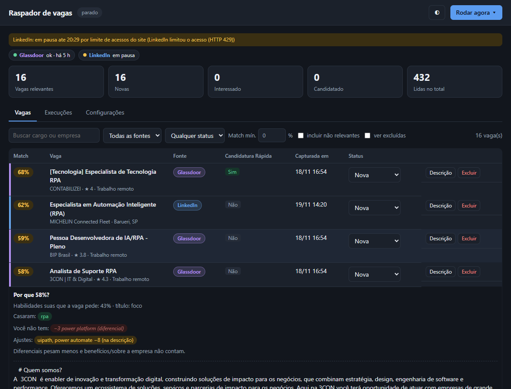

# Raspador de vagas

Coleta vagas **remotas** de RPA/automação em mais de um site, calcula **quanto cada vaga combina com o seu perfil** e mostra tudo num **painel web local**. Feito para quem procura vaga de desenvolvedor RPA (Python, Selenium, n8n), mas as regras de pontuação ficam num `config.json` e dá para adaptar a outro perfil.



## O que faz

- **Várias fontes** (Glassdoor e LinkedIn hoje), cada uma como um módulo independente.
- **% de aderência por vaga**, com explicação ("Por que 58%?"): habilidades suas que a vaga pede, lacunas (o que você não tem) e ajustes de nível.
- **Lê a descrição por seções**: o que está em *Requisitos/Responsabilidades* pesa 100%, o que está em *Diferenciais/Desejável* pesa 30% e *Benefícios/Sobre a empresa* não conta.
- **Painel local**: filtros, status por vaga (nova, interessado, candidatado, descartado), descrição completa, data de captura, execução manual com progresso ao vivo, histórico de execuções e edição dos termos de busca.
- **Excluir sem a vaga voltar**: "Ocultar" mantém o ID no banco, então a vaga não é coletada de novo. "Apagar definitivamente" remove do banco (se o site ainda listar a vaga, ela pode reaparecer).
- **Execução agendada** pelo Agendador de Tarefas do Windows, só com vagas novas.
- **Saúde das fontes**: avisa quando um site parece ter mudado o layout (buscas vazias, descrições vazias) e coloca a fonte em **pausa com backoff** (3h, 6h, 12h, 24h) quando o site bloqueia o acesso (HTTP 429).
- **Trava entre processos**: painel, tarefa agendada e terminal não rodam ao mesmo tempo.

## Requisitos

- **Windows** (usa o Microsoft Edge instalado e APIs do Windows para a trava de processos).
- **Python 3.10+**.
- **Microsoft Edge** instalado. Não precisa rodar `playwright install`: o raspador abre o Edge já instalado e se conecta a ele.

## Instalação

```bash
git clone https://github.com/GleidsonVian/raspador-de-vagas.git
cd raspador-de-vagas
pip install -r requirements.txt
```

## Uso

### Painel (recomendado)

```bash
python -m raspador
```

ou dê duplo clique em `iniciar_painel.bat`. Abre em <http://127.0.0.1:8765> (acessível só neste computador). Use **Rodar agora** para buscar; deixe a janela do terminal aberta enquanto usa o painel.

### Linha de comando

```bash
python cacador.py                          # todas as fontes ativas, todos os termos
python cacador.py --fonte linkedin         # só uma fonte
python cacador.py --termo rpa --termo n8n  # só esses termos
python cacador.py --dias 7                 # só vagas dos últimos 7 dias
python cacador.py --reavaliar              # recalcula o match das vagas salvas (depois de mudar o config.json)
python cacador.py --manter-aberto          # não fecha o Edge do Glassdoor ao terminar
```

### Busca diária automática

`executar_busca.bat auto` roda a busca completa e grava o progresso em `log.txt`. Para agendar todo dia às 09:00:

```bash
schtasks /Create /TN "RaspadorDeVagas" /SC DAILY /ST 09:00 /TR "\"C:\caminho\raspador-de-vagas\executar_busca.bat\" auto"
```

Se houver vagas novas relevantes, um relatório `novas_AAAAMMDD_HHMM.html` abre no navegador. O PC precisa estar ligado e com você logado (o Edge abre com janela).

### Primeira execução do Glassdoor

O Glassdoor usa Cloudflare. Se aparecer **"Confirme que é humano"** na janela do Edge, clique no checkbox; o raspador espera até 5 minutos e segue. O Edge usa um perfil próprio (`perfil_edge/`, criado na hora), então o cookie fica salvo para as próximas vezes. O login no Glassdoor não é necessário.

## Como o match é calculado

```
match = 55% × cobertura de habilidades + 45% × título  +  ajustes
```

- **Cobertura**: das tecnologias que a vaga cita, quanto do total são habilidades suas (`meu_perfil`, com pesos). Tecnologias fora do seu perfil (`tecnologias_outras`) diluem a cobertura.
- **Título**: 100% se citar RPA/UiPath/n8n/Selenium/automação, 50% se citar Python/scraping/integração, 10% nos demais casos.
- **Ajustes**: nível no título (`nivel`), ferramentas em que você não é forte (`ferramentas_fracas`, entram na lista com menos prioridade) e **lacunas** (`lacunas`: GCP, Dataverse, certificações etc.), com teto de `lacunas_max_penalidade`.
- **Relevância** (filtro): a vaga só aparece se tiver um termo núcleo de RPA no título ou ao menos dois na descrição (`termos_nucleo`), não for QA/teste (`bloqueia_qa`) e não for híbrida/presencial (`bloqueia_titulo`).

Tudo isso fica em `config.json`. Depois de editar, use `python cacador.py --reavaliar` ou o botão **Reavaliar vagas salvas** no painel.

## Configuração (`config.json`)

| Chave | O que controla |
|---|---|
| `termos_busca` | termos buscados no Glassdoor, em ordem de prioridade |
| `fontes.linkedin.termos` | termos do LinkedIn (poucos, o site limita acessos) |
| `fontes.<fonte>.ativa` | liga/desliga uma fonte |
| `apenas_ultimos_dias` | idade máxima da vaga |
| `pontuacao_minima` | corte de relevância |
| `meu_perfil` | suas habilidades e o peso de cada uma |
| `lacunas` / `lacunas_max_penalidade` | requisitos que você não tem e quanto cada um desconta |
| `ferramentas_fracas` / `penalidade_fracas` | ferramentas que entram com menos prioridade |
| `peso_diferencial` (opcional, padrão 0.3) | peso do que a vaga marca como diferencial |

Os termos de busca e os limites também dá para editar na aba **Configurações** do painel.

## Estrutura

```
cacador.py            CLI (usada pelo agendador)
raspador/
  __main__.py         python -m raspador  -> abre o painel
  servidor.py         API FastAPI + serve a tela (127.0.0.1)
  web/index.html      tela do painel (HTML/JS, sem build)
  runner.py           orquestra uma execução (fontes, termos, filtros, alertas)
  pontuacao.py        relevância, seções da descrição e % de aderência
  banco.py            SQLite: vagas, execuções, pausas
  trava.py            trava entre processos
  fontes/
    glassdoor.py      Edge real via CDP (o desafio "Confirme que é humano" é resolvido por você)
    linkedin.py       busca pública, sem login
```

### Adicionando um novo site

Crie `raspador/fontes/meusite.py` com uma classe que seja *context manager* e tenha `NOME`, `ROTULO`, `buscar(termo) -> list[dict]` (campos: `id`, `titulo`, `empresa`, `idade_dias`, `local`, `link`) e `descricao(vaga) -> str`, e registre-a em `raspador/fontes/__init__.py`. Se o site bloquear o acesso, levante `Bloqueio`: a fonte entra em pausa sozinha. O painel, a pontuação e a exclusão passam a valer para a nova fonte sem mais mudanças (a cor da fonte no painel é definida em `index.html`).

## Segurança e limites

- O painel escuta **só em `127.0.0.1`**, recusa hosts diferentes (DNS rebinding) e exige um header customizado nas escritas (CSRF).
- **Não versione `perfil_edge/`**: é um perfil de navegador com cookies. Ele e os bancos `*.db` já estão no `.gitignore`.
- **LinkedIn**: o projeto usa **somente** os endpoints públicos de busca, **sem login e sem a sua conta**, com ritmo lento e limite de descrições por execução. O LinkedIn bloqueia acessos automatizados com rapidez (HTTP 429); quando isso acontece a fonte fica em pausa automaticamente. Não use sua conta nem a API interna do app.
- **Termos de uso**: raspagem pode violar os termos de uso dos sites. Este projeto é para **uso pessoal e de baixo volume**; você é responsável pelo uso. Não há vínculo com Glassdoor ou LinkedIn.
- Os sites mudam o HTML sem aviso. O painel mostra um alerta quando uma fonte começa a ler zero vagas, mas o ajuste do parser é manual.

## Limitações conhecidas

- Só Windows por enquanto.
- Ainda não há testes automatizados.
- O LinkedIn rende poucas vagas por execução (é de propósito, para não ser bloqueado).
- A leitura de "obrigatório x diferencial" depende de a descrição ter cabeçalhos como "Requisitos" e "Diferenciais".
